

  

  <a href="#about"><code>about/</code></a> &nbsp;
  <a href="#stack"><code>stack/</code></a> &nbsp;
  <a href="#projects"><code>projects/</code></a> &nbsp;
  <a href="#contact"><code>contact/</code></a>

## about/

  

I'm **Francisco Jordá**, a Software Engineering student at the University of Málaga, originally from Venezuela and now based in Spain. I mostly build full-stack applications with Java, Spring Boot and TypeScript.

- I'm currently building **Casa Esperanza**, my final-year project.
- I'm currently reading [*Designing Data-Intensive Applications*](https://www.oreilly.com/library/view/designing-data-intensive-applications/9781098119058/), 2nd edition.
- [Academic CV](https://drive.google.com/file/d/1zllp-el-E6mX-0vfJEo5L1HXv2AxyUqn/view?usp=sharing)

## stack/

  

**Languages**

**Backend and data**

**Frontend and mobile**

 

**Testing and observability**

  

**Tools**

   

  

## projects/

### UrbanPulse

  

Team-built cloud platform for managing urban incidents reported by citizens, enriched with contextual data from the city of Málaga. It has a web client and a mobile app.

<a href="https://github.com/Dalibex/urban-incidence-manager"></a>

### FireSentinel

  

Wildfire analysis on Sentinel-2 satellite imagery: it outlines the burned area and its perimeter, detects active fire spots and fronts, and estimates smoke direction. It trains no model, relying on rules based on SWIR band physics. Built at III Malackathon 2026 for the INDRA Espacio challenge.

<a href="https://firesentinel.dalibex.dev"></a>

### Casa Esperanza

  

My final-year project, in progress: a custom web app for Casa de la Esperanza, a non-profit in Málaga that supports people who are homeless or in vulnerable situations. It replaces paper notebooks and scattered spreadsheets with a single system for case files and services, clothing inventory, accounting and grant reporting, and the food traceability required by Spain's Law 1/2025.

### Dream Sync

  

Homebrew app for the Nintendo 3DS that backs up and syncs save files through GitHub, right from the console. The repository is private.

## contact/

  

  
  

<code>Connection to fjjorda closed.</code>

